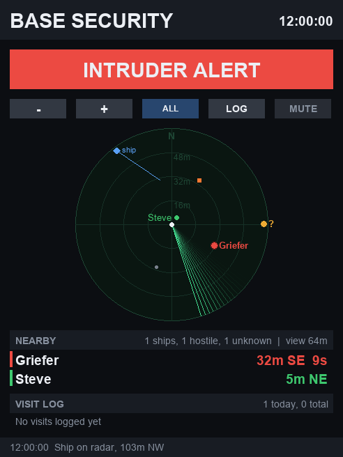

# CC Player Alarm

ComputerCraft base security for an Advanced Peripherals Player Detector. When a player who isn't on the allowed list comes within range, it:

- shows **INTRUDER ALERT** with a live radar, their distance, compass direction and time on site,
- turns on a redstone alarm,
- rings a speaker,
- sends a toast to every allowed player who's online (if a Chat Box is attached),
- warns again if they get close.

Every visit is logged with the time it started, how long it lasted and the closest the player got.

Players in `WATCH_JOINS` (default: `Mechanoo`) are treated as enemies. When one joins, the allowed players who are online get an **ENEMY DETECTED** chat message (once per session: a reboot or chunk reload while they're still on doesn't announce them again), Discord gets a post without a ping, and every join and leave is logged with how long they stayed (LOG page, ENEMY filter, and `!enemylog`). An amber ENEMY bar shows on the monitor while they're on.

## Discord

Alerts can also go to a Discord channel through a webhook, no bot or server needed:

1. In Discord: channel settings, **Integrations**, **Webhooks**, **New Webhook**, **Copy Webhook URL**.
2. Paste it at the top of the file: `DISCORD_WEBHOOK = "https://discord.com/api/webhooks/..."`
3. On the computer, **Tools**, **Test Discord**.

It posts intruders arriving, getting close and leaving, and enemies coming online and going offline. Keep the URL private: anyone who has it can post to that channel.

To ping a role when someone is at the base (intruder alerts only; enemy joins never ping), set `DISCORD_MENTION = "<@&ROLE_ID>"`. The easiest way to get the ID: type `\@Role Name` in any Discord channel and send it; Discord shows the raw `<@&...>` form to copy.

## Discord bot commands

With a Discord bot's token the computer also answers commands in a channel (no hosting needed; it checks the channel every few seconds):

| Command | What it does |
| --- | --- |
| `!whoonline` | who's on the server (allowed, enemy, other) and who's near the base |
| `!status` | intruders, enemies online, alarm state, radar |
| `!visits [n]` | the last n visits |
| `!where <player>` | distance, direction and coordinates of a player near the base |
| `!say <message>` | posts a formatted message in Minecraft chat (10 s cooldown) |
| `!mute [minutes]`, `!unmute` | admins only |
| `!help` | the list |

Setup:

1. Discord Developer Portal, your app, **Bot**: copy the token (Reset Token if needed) and turn on **Message Content Intent**.
2. Make sure the bot can see, read history and send messages in the channel.
3. Discord settings, Advanced, **Developer Mode** on. Right-click the channel, **Copy Channel ID**; right-click yourself, **Copy User ID**.
4. At the top of `startup.lua` on the computer:
   ```lua
   DISCORD_BOT_TOKEN = "your bot token"
   DISCORD_CHANNEL_ID = "channel id"
   DISCORD_ADMINS = { "your user id" }
   ```
   Keep the token private and never put it on GitHub. If the same bot already runs other code that uses `!` commands, change `DISCORD_PREFIX`.

## Create Radar

Any Create Radar on the computer or its cable is found automatically (anything with Create Radar's `getTracks` command: radar bearing, plane radar, or radar monitor), including ones added later. With a radar, the **MODE** button cycles:

- **PLAYERS**: just the Player Detector.
- **THREATS**: plus hostile mobs, projectiles, ships, and players the detector can't see (shown as amber `?`).
- **ALL**: everything except dropped items.

Radar players standing where the detector sees someone get that player's name and color. Sable ships show in every mode as cyan hulls and Create contraptions as purple crates, pointing the way they're heading and shrinking as you zoom out; the radar only labels players, and the Nearby rows and the tap-for-details panel name them (SHIP 1, TRAIN 1, GANTRY 1, CONTRAPTION 1), with a wake, a dashed line to where they'll be in 5 seconds, distance and measured speed (or "parked"); they also get their own rows under Nearby. New ships are noted in the log (`SHIP_WARN = true` also toasts the allowed list). Tracks are placed using the calibrated detector position (or a plane radar's own position), so calibrate first. Zoom can go out to the radar's range. `RADAR_MODE` sets the starting mode.

## Monitor

The monitor works like a small website:

- **Pages** across the top: **RADAR**, **PEOPLE** (intruders, allowed players, vessels and unknown players; tap a row to expand it, with a button to show it on the radar), **LOG** (visits grouped by day, with All / Today / 7 days filters; tap a visit for details) and **STATS** (visit counts, visits per day, top visitors, busiest hours).
- **Scrolling** with the mouse wheel while looking at the screen, or by dragging; a scrollbar shows where you are.
- **Hover**: buttons and rows light up where you're looking.
- It returns to the radar after a minute without input, and straight away when an intruder arrives.

## Monitor controls

- **- / +**: zoom the radar (view only). East is at the top by default; `RADAR_UP` turns it (north, east, south or west), with N/E/S/W marked on the rim.
- **MODE**: radar view mode (needs a Create Radar).
- **Tap anything on the radar** (or a row under Nearby): details for players (coordinates, direction, time here, closest distance, past visits), ships and contraptions (type, coordinates, speed and heading), mobs and unknown players. Tap empty radar to close.
- **MUTE**: silences the siren and speaker for `MUTE_MINUTES`. It's locked until an allowed player right-clicks the Player Detector, so an intruder can't silence it from the monitor. An intruder right-clicking the detector sends an alert instead. Mute/unmute any time from the computer. Made for a 3 wide, 4 tall monitor with a DirectGPU block; plain monitor text works too.



## Install

```
wget https://raw.githubusercontent.com/levisnakes/cc-player-alarm/main/player_alarm.lua startup.lua
```

## Setup

1. Put the Player Detector, and optionally a Chat Box and a speaker, next to the computer or on its wired-modem cable.
2. Put a monitor (3 wide, 4 tall) and a DirectGPU block on the computer.
3. Edit the top of the file: `ALLOWED` names, `RANGE`, `ALARM_SIDE`, `UTC_OFFSET` for local times in the log.
4. Stand on top of the Player Detector by yourself and press **Calibrate** on the computer. This gives the radar real directions. Before you do, distances are still exact but blips are placed at a fixed angle per player.

The computer screen has three tabs:

- **Status**: what's connected, whether the detector is calibrated, radar status, and nearby players with an **Allow** button.
- **People**: the allowed list (names from `ALLOWED` in the file are always allowed and marked `file`; ones added on the computer can be removed) and the enemy list with who's online.
- **Tools**: Calibrate, Mute, **Test enemy msg** (sends the enemy chat message to the allowed list only, marked as a test), **Test alert** (a toast to the allowed list), and Clear log (asks to confirm). Everything on the monitor except MUTE only changes the view, and MUTE needs the detector unlock.

## config.lua

Anything in `/config.lua` on the computer overrides the settings at the top of the program, and survives reinstalls and updates. One file can be shared by every computer; each program ignores settings it doesn't use. Example:

```lua
DISCORD_WEBHOOK = "https://discord.com/api/webhooks/..."
DISCORD_MENTION = "<@&ROLE_ID>"
ALLOWED = { "YourName", "Friend" }
INPUT_CHEST = "minecraft:chest_3"
```
